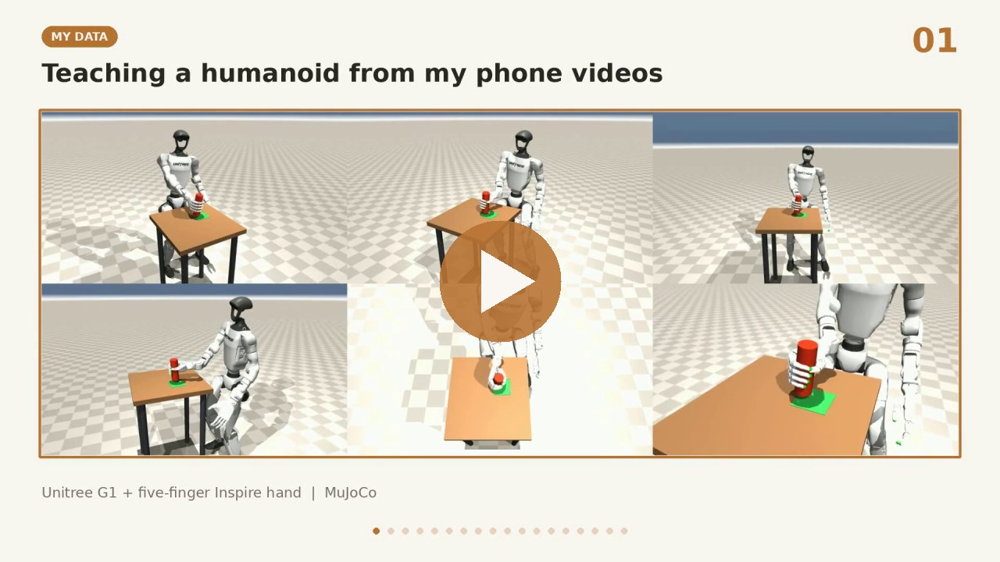
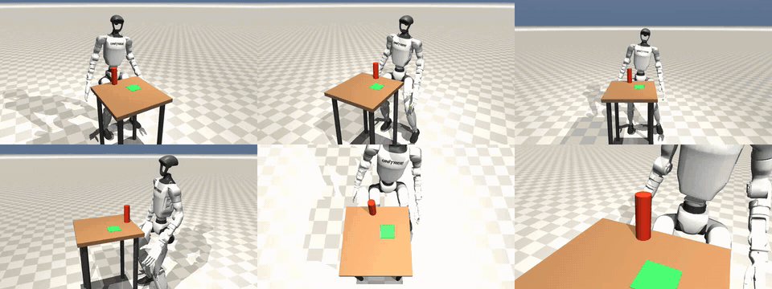
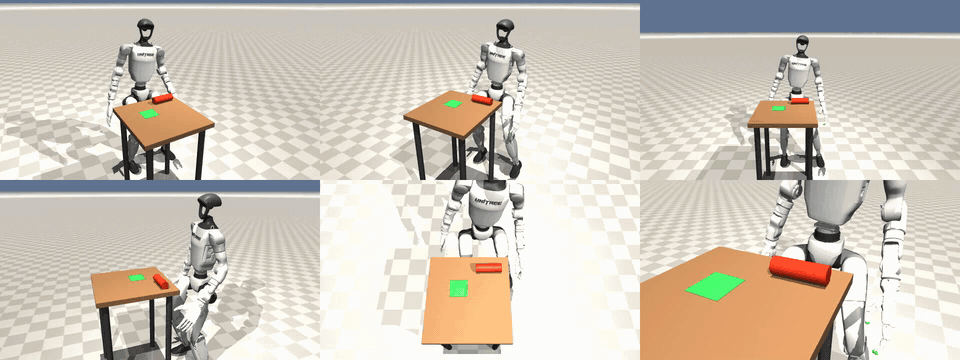
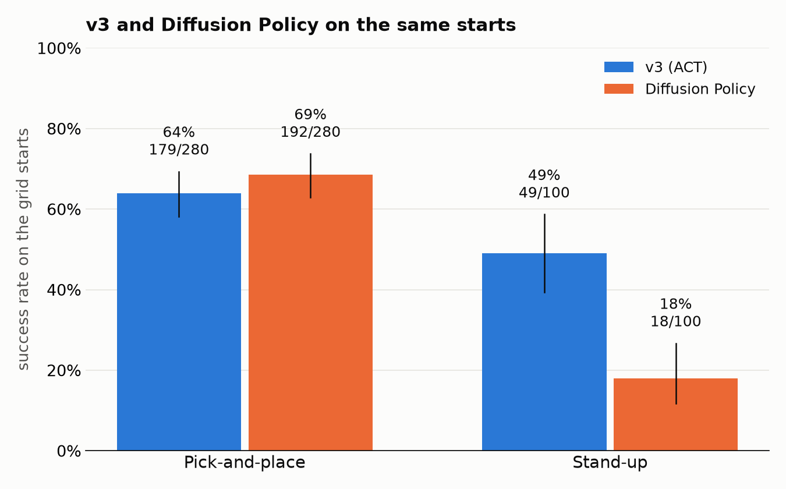
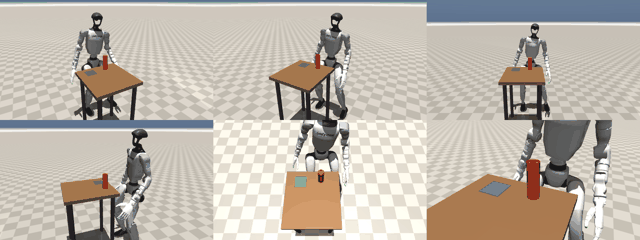

# g1-imitation: phone videos of my hand to a G1 humanoid in MuJoCo

A Unitree G1 humanoid with a five-finger Inspire hand does two cylinder tasks in MuJoCo, learned from phone videos
of my own right hand:

- **Pick-and-place:** pick up a standing cylinder and place it upright on a goal.
- **Stand-up:** pick up a lying cylinder and stand it upright on a goal.

One camera-based policy (imitation learning) does both tasks and picks the grip from what it sees. The final policy
is ACT (v3); a Diffusion Policy trained on the same data is compared against it below.

Entry for the Awign x Armature AI Labs Humanoid Challenge (Nov 2026). Direction taken: *post-train a policy on a
simple task using your own recordings*, with five-finger retargeting and touch-gated grasping, plus attempts to push
the success rate up with RL and self-improvement (results below, including the ones that failed).

## Key features

- **My own data:** 54 phone clips of my hand (38 used) turned into 3,857 simulated demonstrations; only replays
  that succeed are kept.
- **One camera-based policy for two tasks:** pick-and-place and standing a lying cylinder upright. No task label;
  the policy tells the tasks apart from its head and wrist cameras.
- **Five-finger human grip:** thumb and index hold, the other fingers rest and close in sequence, as in my videos.
  The lift waits until the fingers actually touch the cylinder.
- **A humanoid that stays standing:** a RL balance policy holds the G1 while its right arm works.
- **Like-for-like evaluation:** the same seeded starts for every policy, success computed from the simulator state,
  every trial saved as video; ACT and Diffusion Policy compared on the same 380 starts.

## Watch the walkthrough

[](https://youtu.be/CvTkpJ8X3cs)

A narrated walkthrough (2 min 46 s) of the whole project
(also in `media/journey.mp4`).

## The robot in action

**Pick-and-place** :



**Stand-up** :



*The policy alone drives the arm and hand, from the head and wrist cameras and the joint angles.*

---

## Contents

1. [Overview](#overview)
2. [Results at a glance](#results-at-a-glance)
3. [System architecture](#system-architecture)
4. [Repository structure](#repository-structure)
5. [Installation](#installation)
6. [Dataset preparation](#dataset-preparation)
7. [Usage guide](#usage-guide)
8. [Configuration](#configuration)
9. [Results and benchmarks](#results-and-benchmarks)
10. [Journey: what worked, what didn't, assumptions](#journey-what-worked-what-didnt-assumptions)
11. [Credits and licenses](#credits-and-licenses)
12. [License](#license)
13. [Appendix](#appendix)

---

## Overview

```
my phone clips (.MOV)          ->  hand keypoints (WiLoR), A4 ArUco board (camera pose, scale),
                                   cylinder track, phases (reach, grasp, carry, place, release)
                                                    |
                                                    v
                                   replay on the simulated G1, many randomized trials per clip
                                   (the clip gives the cylinder's move, carry path, finger timing)
                                                    |
                                                    v
                                   successful trials only -> head + wrist camera, joint states,
                                   joint targets -> LeRobot dataset -> ACT policy
                                                    |
                                                    v
                                   the policy alone drives the arm and hand, evaluated on new starts
```

My own data matters in three places: each clip sets **where the cylinder goes** (38 different moves), **how it is
carried** (the carry path, and the wrist turn for stand-up), and **how the hand grips**. The policy gets goal or task label from its cameras.

---

## Results at a glance

Final policy: **v3** (ACT, 3,857 episodes from 38 of my clips, 400k steps). The same success test for every row:
lifted 8 cm, centre within 4 cm of the goal, within 15 degrees of upright, hand let go, robot standing. Every policy
runs on the same seeded starts. Counts are k/n with a 95% Wilson interval; P = probability that one rate is higher.

| Grid, 10 starts per clip | v3 (ACT) | Diffusion Policy  |
|---|---|---|
| Pick-and-place, 28 clips | 179/280 (64%, 58-69%) | **192/280 (69%, 63-74%)** |
| Stand-up, 10 clips | **49/100 (49%, 39-59%)** | 18/100 (18%, 12-27%) |
| Total | **228/380 (60%)** | 210/380 (55%) |

- **v3 on 860 random starts:** 559 (65%).
- **v3's weak spot: lying cylinders turned 15-30 degrees,** 9/40. v3 learned ten clip-specific stand-up grips, and
  at a turned cylinder it seems to blend them into one that fits none (see Journey).
- **Diffusion Policy** (meant to handle exactly that blending) was best on pick-and-place, though not clearly
  (P(better than v3) = 0.88), and clearly worst on stand-up. Trained 150k steps, about 9 passes over the data,
  without the weight averaging (EMA) the paper uses.
- **Expert ceiling** (the replay that made the data), on 260 random starts of 13 clips: pick-and-place 213/260 (82%),
  stand-up 23/30 (77%).



*Same 380 grid starts for both policies (bar: 95% interval). Diffusion is slightly ahead on pick-and-place
(192/280 vs 179/280); v3 is far ahead on stand-up (49/100 vs 18/100).*

The plot is drawn from the evaluation logs by `scripts/plot_results.py` (data in `media/plot_data.json`).



More videos: [10 tries at once, the successful one solid](media/ten_tries.mp4), and the [Appendix](#appendix).

---

## System architecture

| Stage | What | Tools |
|---|---|---|
| Hand tracking | 21 hand keypoints and a MANO hand per frame | WiLoR (WiLoR-mini), on a GPU |
| Table frame | camera pose, metric scale, field of view fitted per clip | ArUco A4 board, OpenCV |
| Cylinder tracking | standing or lying cylinder, position and axis per frame | dark blob checked against the projected 50 x 150 mm outline |
| Phases | reach, grasp, carry, place, release | longest closed-finger run in the finger closure |
| Replay (expert) | robot's own approach; the demo's move, carry path, wrist turn, finger sequence | mink IK, OMPL RRT-Connect, touch-gated grasp |
| Balance | G1 stands still while the right arm works | pretrained RL locomotion policy + position hold |
| Policy | ACT, both tasks in one network | LeRobot 0.4.4, PyTorch |
| Evaluation | the policy alone drives the arm and hand | `scripts/evaluate.py`, every run saved as video |

### Policy (model card)

- **Algorithm:** ACT (Action Chunking with Transformers), behaviour cloning with a CVAE objective (L1 action loss + 10 x KL). Predicts 50 future actions each step, temporal ensembling 0.01. Trained only on successful replays.
- **Observations:** head camera and wrist camera (240 x 320 RGB each), 7 right-arm joint angles, 6 finger drive
  positions. No task label: the policy tells a lying cylinder from a standing one by looking.
- **Actions:** 13 joint position targets (7 arm, 6 fingers) at 25 Hz.
- **Network:** ResNet-18 (ImageNet) shared by both cameras; transformer encoder 4 layers, decoder 1 layer, width
  512, 8 heads; 52M parameters.
- **Training (v3):** 3,857 episodes (28 pick-and-place clips, 10 stand-up clips), 1,520,864 frames; 400,000 steps
  (about 2 passes over the data), batch 8, AdamW, lr 1e-5, weight decay 1e-4, seed 1000, LeRobot's image
  augmentation; from scratch; about 4 h on a GPU server.
- **Checkpoint choice:** by task success on 114 starts no test uses, not by training loss: 400k (72/114) over 200k
  and 300k (66/114 each).

### Diffusion Policy 

Settings follow the paper's real-world image setup (Chi et al., IJRR; Tab. 7 and the official
`train_diffusion_unet_real_image_workspace.yaml`), as far as LeRobot 0.4.4 supports them: 2 observation frames,
16-step action horizon, 8 executed; ResNet-18 from scratch per camera, GroupNorm, spatial softmax; random crop
216 x 288; 1-D U-Net 512/1024/2048 with FiLM; DDIM, 100 noise steps; AdamW 1e-4, cosine schedule, 500 warmup steps;
batch 64; 278M parameters. 150k steps (5 h 16 min), about 9 passes over 2,723 episodes (the over-represented
stand-up clip IMG_8510 capped at 116 of its 1,250 episodes). Final checkpoint, 100 denoising steps at test.
Not done: EMA of the weights (the paper and official code use it; LeRobot 0.4.4 has none).
- **Physics:** MuJoCo 3.17.0, 5 ms step, 20 ms control; elliptic friction cones, impratio 10.

### Balance policy (reinforcement learning)

PPO (RSL-RL) velocity tracking for the G1 with Inspire hands, trained in MJLab.
It only follows walking-speed commands, so this project adds a position-hold loop that turns it into a stand-still
balancer and routes the arm's gravity compensation through the arm motors. Its right arm and hand outputs are
replaced by the IK (replays) or by ACT (policy). Motor gains and default pose are copied from its training config.
Measured: 0 steps and 0.003 rad/s sway while the right hand works.

---

## Repository structure

```text
config.toml          every tunable value (scene, grasp, IK, replay, evaluation)
src/g1_imitation/    robot, scene, balance, IK, motion planner, episode, hand tracking, retargeting
scripts/             command-line steps, in pipeline order (see Usage)
data/                clips, tracked hands, processed demos, clip metadata (data/README.md)
assets/              downloaded robot models, not committed (scripts/download_assets.sh)
media/               the plot and videos shown in this README (plot data in media/plot_data.json)
outputs/             videos, plots, evaluation results; checkpoints not committed
```

`arm_ik`, `hand_tracking`, `motion_planner` and `retarget` have self-checks: `python src/g1_imitation/<module>.py`.

---

## Installation

Simulation and demo processing (Linux; on Windows use WSL2, OMPL has no Windows build):

```bash
git clone <this repo> && cd <repo>
python3 -m venv .venv && source .venv/bin/activate
pip install torch --index-url https://download.pytorch.org/whl/cpu   # CPU build is enough for replays
pip install -e .            # add ".[tools]" for the grasp search, the README plot and the showcase video
scripts/download_assets.sh
```

Training and evaluation (NVIDIA GPU):

```bash
pip install lerobot==0.4.4 mujoco==3.17.0 onnxruntime==1.31.1   # plus a CUDA torch, e.g. 2.10.0+cu128
```

Hand tracking: [WiLoR-mini](https://github.com/warmshao/WiLoR-mini), needs a GPU.

---

## Dataset preparation

**Recording (my data).** iPhone 15 Pro Max on a tripod at about 45 degrees, an A4 ArUco board on the table, a
50 x 150 mm 3D-printed cylinder, right hand only. 35 pick-and-place clips (IMG_8462 to IMG_8498, 3 camera setups)
and stand-up clips (IMG_8489 to IMG_8493, IMG_8506 to IMG_8520).

```bash
# 1. Hand keypoints (GPU machine) -> data/hands/<clip>.npz
python scripts/track_hands_wilor.py data/raw/IMG_*.MOV
# 2. Camera pose, hand, cylinder, phases -> data/processed/<clip>.npz, data/phases.csv
python scripts/process_demos.py data/raw/IMG_8473.MOV
# 3. Replay the clip and keep successful randomized trials as training episodes
python scripts/replay_demos.py IMG_8473 --trials 100 --record data/episodes
# 4. Draw head and wrist images from the saved poses, then build the LeRobot dataset
python scripts/render_episodes.py data/episodes
python scripts/to_lerobot.py data/episodes data/lerobot/g1_inspire
```

---

## Usage guide

### 1. Imitation learning (ACT)

```bash
lerobot-train --dataset.repo_id=local/g1_inspire --dataset.root=data/lerobot/g1_inspire \
  --dataset.image_transforms.enable=true --policy.type=act --policy.chunk_size=50 --policy.n_action_steps=1 \
  --policy.temporal_ensemble_coeff=0.01 --policy.device=cuda --policy.push_to_hub=false \
  --batch_size=8 --steps=400000 --seed=1000 --wandb.enable=false --output_dir=outputs/act_v3

# Diffusion Policy on the same kind of dataset (settings in the model card)
lerobot-train --dataset.repo_id=local/g1_inspire_diffusion --dataset.root=data/lerobot/g1_inspire_diffusion \
  --policy.type=diffusion --policy.crop_shape='[216,288]' --policy.use_separate_rgb_encoder_per_camera=true \
  --policy.noise_scheduler_type=DDIM --policy.push_to_hub=false --batch_size=64 --steps=150000 --seed=1000 \
  --wandb.enable=false --output_dir=outputs/diffusion
```

`scripts/evaluate.py` runs either policy (it reads the policy type from the checkpoint).


### 2. Evaluation

```bash
C=outputs/act_v3/checkpoints/400000/pretrained_model
python scripts/evaluate.py $C --grid --trials 10              # 13 clips x 10 grid starts, videos in outputs/evaluate/
python scripts/evaluate.py $C --random-goals --trials 10      # start and goal anywhere in reach
python scripts/evaluate.py $C --turn-cylinder -30              # lying cylinder turned by -30 degrees
python scripts/evaluate.py $C --set object.mass=0.35           # override any config.toml value
python scripts/evaluate.py $C --live                           # watch in the MuJoCo viewer
```

---

## Configuration

Every tunable value is in `config.toml`. Example, the success test and the workspace:

```toml
[episode]
lift_success = 0.08     # object must have been lifted at least this high
place_tolerance = 0.04  # final object center within this distance of the goal; 3 cm until 2 Nov
max_tilt_deg = 15       # and standing upright
workspace = [[0.25, -0.32], [0.40, -0.10]]  # where the hand reaches grasp height within ~2 cm
```

---

## Results and benchmarks

### How the policies are evaluated

Following Kress-Gazit et al. 2024 (["Robot Learning as an Empirical Science"](https://arxiv.org/abs/2409.09491)):

- **Same starts for every method.** The simulator is deterministic and starts are seeded, so a policy and the
  expert see the exact same scenes.
- **No evaluator judgment.** Success is computed from the simulator state, with criteria fixed before the run.
- **Counts and uncertainty.** k/n, 95% Wilson interval, and the probability that one rate is higher than another
  (uniform prior, binomial counts).
- **More than success.** Each failure is labelled by the first test it fails (not lifted, tipped over, off the
  goal, not let go); landing error and lift height are recorded.
- **One training run per version** (seed 1000). Part of a difference between versions can come from training
  randomness; a second seed was not run.

### v3 test scenarios (seeded; 3,000+ videos)

| Scenario | v3 |
|---|---|
| S1 grid repeat, 38 clips x 10 | 231/380 (61%) |
| S2 random starts | 559/860 (65%) |
| S3 random start and goal, pick-and-place / stand-up | 18/100 / 6/30 |
| S4 lying cylinder turned +30 / +15 / -15 / -30 deg | 0/10, 3/10, 6/10, 0/10 |
| S5 mass 0.15 / 0.35 kg (data: 0.25) | 123/240 / 114/240 |
| S6 friction 0.3 / 0.6 | 147/240 / 143/240 |

Reading it: v3 does well inside the range the data covers (new starts of the recorded moves) and breaks outside it
(turned cylinders, goals anywhere in reach). Friction barely matters; mass costs 10-13 points either way, because
the data used one mass.

### RL fine-tuning on top of an earlier version (13 clips)

- **RoboCat** (the policy's own practice successes added to the data, retrained): 469/598 pick-and-place and
  597/600 stand-up practice runs succeeded, 1,066 episodes kept; 400k-step training on the server.
  Same 130 grid starts: pick-and-place **100/130** (the policy before it: 97/130; P(better) = 0.67, not a clear gain),
  stand-up IMG_8510 10/10 (before: 10/10). Per clip it is not uniformly better: IMG_8477 to IMG_8480 improved (3-5 to
  5-8 of 10), while IMG_8464, IMG_8470, IMG_8484 and IMG_8494 dropped (by 2-3 of 10 each).
---

## Journey: what worked, what didn't, assumptions

### Versions

| Version | What changed | Data | Pick-and-place | Stand-up |
|---|---|---|---|---|
| v1 | ACT, robot's top-down grip (all four fingers squeeze) | 529 eps | 13/118 | |
| v2 | grip copied from my videos: thumb and index hold, other fingers rest | 1,204 eps | 107/118 (expert 108/118) | |
| **v3** | both tasks in one policy (stand-up added, grasp searched per clip); fingers close in sequence and support fingers stop at contact; elliptic friction cones; all 38 usable clips; checkpoint chosen by task success | 3,857 eps | 179/280 (28 clips) | 49/100 (10 clips) |
| Diffusion | Diffusion Policy instead of ACT, same data  | 2,723 eps | 192/280 | 18/100 |

v1 and v2 used the older, looser test ; v3 and Diffusion use the
current test on 380 grid starts over all 38 clips. Numbers across the two tests are
not comparable.

### What worked

- **Copying the object's motion, not the hand's.** The first replay copied my hand pose from the video, and the
  robot hand landed beside the cylinder: depth from one camera was too noisy (from overhead, a resting hand read
  30-36 cm above the table). Following RSRD, the robot uses its own approach and takes the cylinder's move, carry
  path and timing from the clip.
- **Copying my grip.** I hold the cylinder like a bottle: thumb and index squeeze, the other three only rest. The
  robot's first grip closed all four fingers hard, which pushed the base sideways and tipped it 23-38 degrees
  before the lift. With my grip, replay success on the same 130 trials went from 57 to 123, and the policy from
  13/118 (v1) to 107/118 (v2). Video gives finger positions, not force, so the force split was set in
  `config.toml [grasp]`.
- **Touch-gated grasping.** The lift waits until thumb and a finger touch the cylinder (MuJoCo contacts used as
  touch sensors); support fingers curl until contact and stop there.
- **WiLoR instead of MediaPipe.** MediaPipe drew the hand on the forearm when the fingers wrap the cylinder (48 of
  87 frames jumped more than 3 cm); WiLoR found the hand in every frame of the test clips.
- **Only successes as training data, many randomized starts per clip.** 100 or more trials per clip with the start
  shifted; the expert's failures never reach the policy.
- **Saving poses instead of images during generation.** Rendering in WSL2 managed about 10 images/s; generation
  saves only poses and the images are drawn later (they match live renders in all but 108 of 76,800 pixels).

### What didn't work

- **Other hands.** Unitree Dex5-1: the thumb never touched (1-2/10). Sharpa Wave: the arm sagged 6-7 cm under the
  1.32 kg hand at the balance policy's arm gains (0/10). Kept as git tags `dex5-1-hand`, `sharpa-wave-hand`.
- **Reach.** The arm reaches grasp height only in about 15 x 22 cm. My clips move the cylinder 25-41 cm, so each
  move is centred in that box and shortened. Walking (knees 3 cm from the table) and bending the waist (the balance
  policy falls, 0/5) were tried and removed.
- **Release tipping.** The cylinder tilted about 15 degrees in the grip and tipped when the thumb or wrist brushed it
  at release. Pressing lower, pulling the palm away and more torsional friction gave no gain. It is still the
  expert's largest failure group (18 of 47 failures in S7).
- **Adding stand-up to the first policy.** The first combined policy did 0/30 on stand-up and lost some
  pick-and-place (100/118 vs 107/118).
- **The physics change.** A slow slip of the cylinder in the grip came from MuJoCo's default pyramidal friction
  cone. Elliptic cones (MuJoCo's documented fix) plus the stricter test took the policy of that time from 111/118 to 49/130, so the data was
  regenerated and retrained under the new physics.
- **RL on the stand-up hand plan (ARS).** A small policy correcting the hand's pose from the cylinder's angle: no
  learning trend in 100 + 40 iterations (also with common random numbers). Not used.
- **RoboCat round 1.** Retraining on an earlier policy's own practice successes gave 11/130 (112 trials never lifted). The cause
  was not established.
- **Turned cylinders (v3).** With all 38 clips, stand-up on lying cylinders turned 15-30 degrees is only 9/40. A
  likely cause: ACT averages the ten clip-specific stand-up grips
  (the multimodality problem in behaviour cloning). Not proven; a grip or clip label in the input would test it.
- **Diffusion Policy on stand-up.** Built for that averaging problem, it still scored 18/100 on stand-up (v3: 49/100)
  while being the best on pick-and-place (192/280). Possible reasons: 9 passes over the data where the
  paper trains for hundreds, no EMA, and 16-step action chunks at 25 Hz cover only 0.64 s.


### Assumptions

- Simulation only; no real robot. The cylinder is treated as uniform PLA+, 50 x 150 mm, 250 g.
- Hand height from one RGB camera is unreliable, so heights are scaled (a 10 cm lift read as about 5 cm; carry
  peak set to 12 cm).
- Finger forces are not visible in video; the force split between fingers is my choice, guided by how I hold it.
- The success thresholds (8 cm lift, 4 cm goal, 15 degrees) are mine, fixed before evaluation.
- No noise injection or DAgger: the policy only ever saw the expert's own states.

### Limits of time and compute

- **Late GPU.** A rented GPU server arrived late in the challenge; until then the work ran on my PC and a friend's
  laptop.
  The larger runs (v3, the Diffusion Policy and the full evaluations) all had to fit into the last days.
- **No more recordings.** With the time left I could not record more clips. More stand-up clips, and clips with
  turned or heavier cylinders, are the obvious next step, since those are where v3 fails most.
- **Diffusion Policy was not trained to its full settings.** It got 150k steps (about 9 passes over the data) and no
  weight averaging (EMA), where the paper trains for hundreds of passes with EMA. Its stand-up result (18/100) may
  say more about that short training than about the method.

---

## Credits and licenses

| Asset | Source | License |
|---|---|---|
| G1 29-DoF + Inspire hand MJCF | [xingzewu24/supermimic_vibed](https://github.com/xingzewu24/supermimic_vibed) | MIT |
| Balance policy | [josabb/G1-humanoid-6dof-hands-locomotion-rl](https://huggingface.co/josabb/G1-humanoid-6dof-hands-locomotion-rl) | Apache-2.0 |
| Hand tracking | [WiLoR-mini](https://github.com/warmshao/WiLoR-mini) (MANO hand model) | MANO is non-commercial; WiLoR to check |
| Motion planning | [OMPL](https://ompl.kavrakilab.org) | BSD-3-Clause |
| Arm IK | [mink](https://github.com/kevinzakka/mink) | to check |
| Inspire URDF, finger retargeting | [dex-urdf](https://github.com/dexsuite/dex-urdf), [dex-retargeting](https://github.com/dexsuite/dex-retargeting) | MIT |
| ACT training | [LeRobot](https://github.com/huggingface/lerobot) | to check |

### Papers

| Paper | Used for |
|---|---|
| [ACT: Learning Fine-Grained Bimanual Manipulation with Low-Cost Hardware](https://arxiv.org/abs/2304.13705) (Zhao et al. 2023) | the final policy (v1 to v3) |
| [Diffusion Policy: Visuomotor Policy Learning via Action Diffusion](https://arxiv.org/abs/2303.04137) (Chi et al. 2023) | the compared policy and its settings |
| [Robot See Robot Do](https://arxiv.org/abs/2409.18121) (RSRD, Kerr et al. 2024) | copying the object's motion instead of the hand pose |
| [WiLoR: End-to-end 3D Hand Localization and Reconstruction in-the-wild](https://arxiv.org/abs/2409.12259) | hand tracking from the phone videos |
| [Crossing the Human-Robot Embodiment Gap with Sim-to-Real RL using One Human Demonstration](https://arxiv.org/abs/2504.12609) (Human2Sim2Robot) | correcting the video's stand-up grasp in the simulator |
| [Dexterous Manipulation Policies from RGB Human Videos via 3D Hand-Object Trajectory Reconstruction](https://arxiv.org/abs/2602.09013) (VideoManip) | the same idea, per clip |
| [Simple random search provides a competitive approach to reinforcement learning](https://arxiv.org/abs/1803.07055) (ARS) | the RL correction on the stand-up plan |
| [RoboCat: A Self-Improving Generalist Agent for Robotic Manipulation](https://arxiv.org/abs/2306.11706) | the self-improvement rounds |
| [Residual Off-Policy RL for Finetuning Behavior Cloning Policies](https://arxiv.org/abs/2509.19301) (ResFiT) | the residual RL idea |
| [Robot Learning as an Empirical Science: Best Practices for Policy Evaluation](https://arxiv.org/abs/2409.09491) (Kress-Gazit et al. 2024) | how the policies are evaluated |

---

## License

The code in this repository is released under the MIT License (see `LICENSE`). Third-party assets and tools keep
their own licenses, listed above.

---

## Appendix

- **Videos:** `media/` (10 tries at one clip played together, one success drawn solid, the rest as ghosts; a
  six-camera replay of one trial). Every evaluation trial is also saved as video by `scripts/evaluate.py`;
  `scripts/showcase.py` re-renders any saved trial in a nicer-looking scene from six cameras without changing what
  the policy sees.
- **Data sample in this repo:** raw clips, tracked hands, processed demos, a few generated episodes (see
  `data/README.md`); the full clip set is 1.6 GB.
- **Collection note:** `data/README.md`.
